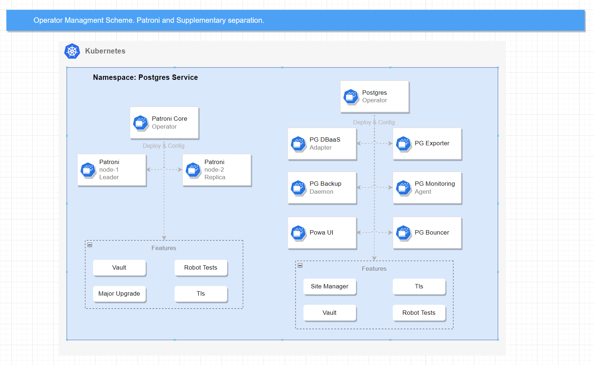
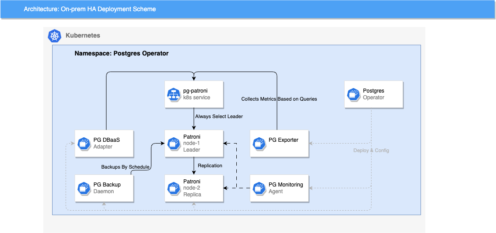

# Architecture

PGSkipper Operator manages PostgreSQL on Kubernetes and OpenShift. Its architecture separates **PostgreSQL cluster management** from **supporting database services**. Kubernetes custom resources describe the desired state, and the corresponding operators reconcile the cluster toward that state.

## Overview

*Figure 1 — Operator responsibilities.* The Core Operator manages Patroni/PostgreSQL resources, while the Services Operator manages supporting services. The diagram is illustrative: component deployment depends on configuration, and tests are not runtime services.

This is a conceptual diagram: enabled components and exact Kubernetes resources depend on the Helm configuration and deployment mode.

## Operators and PostgreSQL

### Patroni Core Operator

The **Patroni Core Operator** reconciles the `PatroniCore` custom resource. It manages the PostgreSQL cluster's Kubernetes resources, including Patroni instances and their persistent storage.

### Patroni Services Operator

The **Patroni Services Operator** reconciles the `PatroniServices` custom resource. It manages services that operate alongside PostgreSQL, such as the backup daemon, monitoring components, the DBaaS adapter, PgBouncer, and replication-related services. Components can be enabled or disabled through configuration.

The operators are packaged in separate Helm charts:

- [`patroni-core`](../../operator/charts/patroni-core/) — PostgreSQL and Patroni cluster management.
- [`patroni-services`](../../operator/charts/patroni-services/) — Supporting services.

### Patroni

[Patroni](https://patroni.readthedocs.io/) provides PostgreSQL high availability. Each Patroni instance supervises a PostgreSQL instance and participates in leader election, failover, and replication management. In the Kubernetes deployment, Patroni uses Kubernetes resources for distributed coordination.

A typical highly available cluster has a primary PostgreSQL instance and one or more replicas. PostgreSQL data is kept on persistent volumes so that recreating a pod does not, by itself, discard the database files.

## Supporting Components

| Component | Responsibility |
| --- | --- |
| **PostgreSQL Backup Daemon** | Exposes backup, status, and restore-related APIs and coordinates backup operations. |
| **pgBackRest** | Provides PostgreSQL backup and recovery functionality through its integration with the deployment. |
| **DBaaS Adapter** | Exposes APIs for managing logical databases, users/roles, and related DBaaS operations. |
| **Monitoring Collector** | Collects database and cluster monitoring data using the monitoring-agent/Telegraf integration. |
| **Metrics and Query Exporters** | Expose PostgreSQL metrics, including configurable SQL-query-based metrics. |
| **PgBouncer** | Pools client connections to PostgreSQL. |
| **Logical Replication Controller** | Supports management of logical replication resources. |
| **Site Manager** | Supports active/standby and disaster-recovery management operations. |

The **backup daemon and pgBackRest are distinct components**. Their configuration and recovery procedures should be documented separately rather than treated as interchangeable.

### DBaaS Registration

The DBaaS adapter supports two registration paths:

- **Legacy registration:** the adapter communicates with the DBaaS aggregator during initialization.
- **Declarative registration:** when DBaaS deployment is enabled and the `PhysicalDatabase` CRD is available to Helm, the services chart can create a `PhysicalDatabase` resource containing the adapter address and a credentials-secret reference. In this mode, the adapter skips legacy aggregator initialization.

The DBaaS aggregator is an external integration, not one of the two PGSkipper operators.

## Deployment Schemes

### High Availability (HA)

In a standard HA deployment, Patroni coordinates PostgreSQL primary and replica instances within a Kubernetes or OpenShift cluster. A replica can be promoted when failover is required.

*Figure 2 — Example HA deployment.* A PostgreSQL service routes traffic to the current primary, while streaming replication keeps a replica synchronized. The leader and replica shown are illustrative roles, not fixed pod identities. Supporting services are optional according to configuration.

### Disaster Recovery (DR)

An active-standby arrangement can span separate Kubernetes or OpenShift clusters. This provides a deployment-level recovery option beyond replication within a single cluster.

*Figure 3 — Example DR deployment.* Two Kubernetes clusters are shown, with WAL replication between the active and standby PostgreSQL clusters. For configuration and recovery procedures, see [Active-Standby Cluster](features/active-standby-cluster.md) and [Disaster Recovery](features/disaster-recovery.md).

### Managed PostgreSQL Services

The Helm charts also contain an `externalDataBase` configuration path for deployments that integrate with externally managed PostgreSQL. These integrations do not have the same PostgreSQL/Patroni ownership model as a cluster managed by the Core Operator. Provider-specific requirements should be confirmed in the [Installation and Configuration Guide](installation.md).

## Related Documentation

- [Documentation Index](../README.md)
- [Quickstart](quickstart.md)
- [Installation and Configuration](installation.md)
- [pgBackRest](features/pgBackRest.md)
- [Connection Pooler](features/connection-pooler.md)
- [Query Exporter](features/query-exporter.md)
- [TLS Configuration](features/tls-configuration.md)
- [Troubleshooting](troubleshooting.md)
